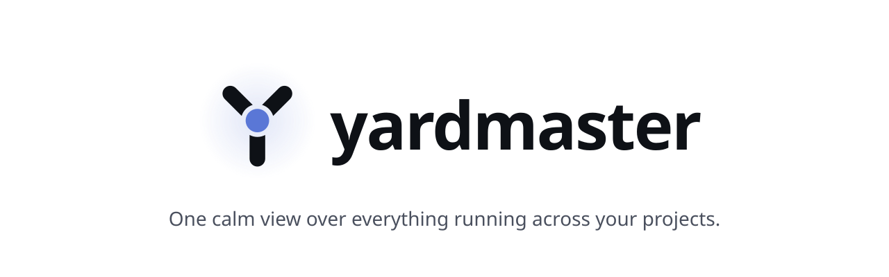
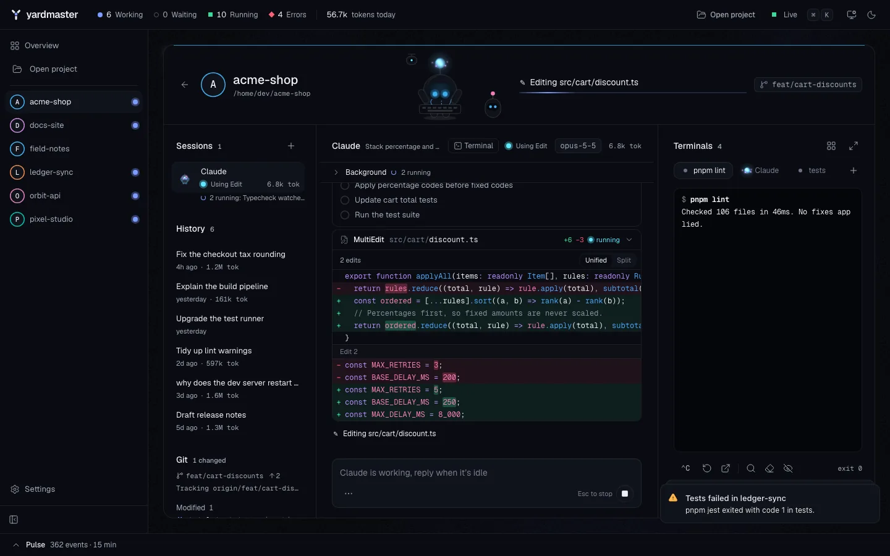
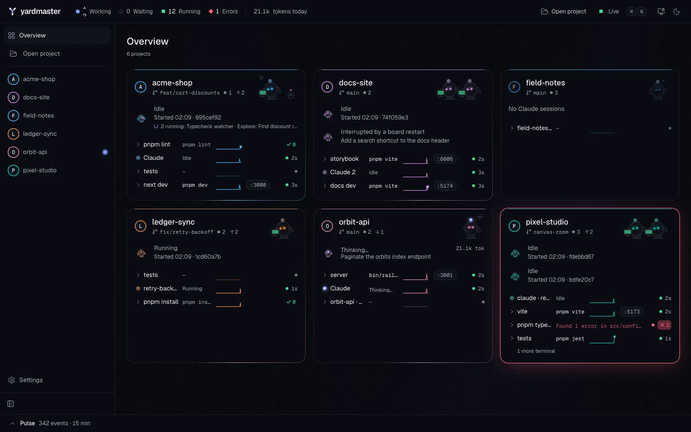
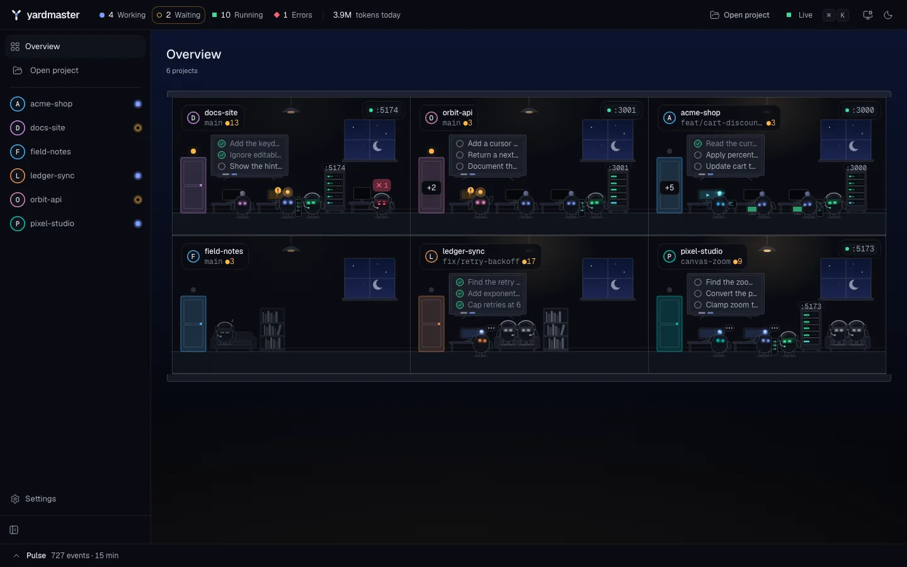
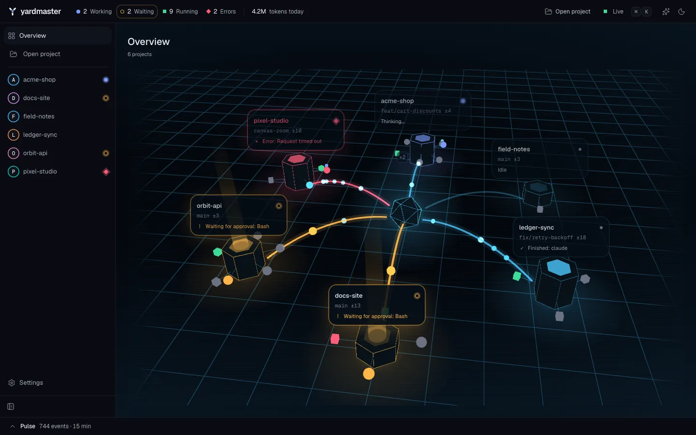
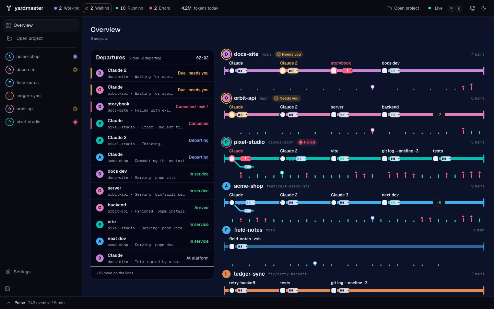
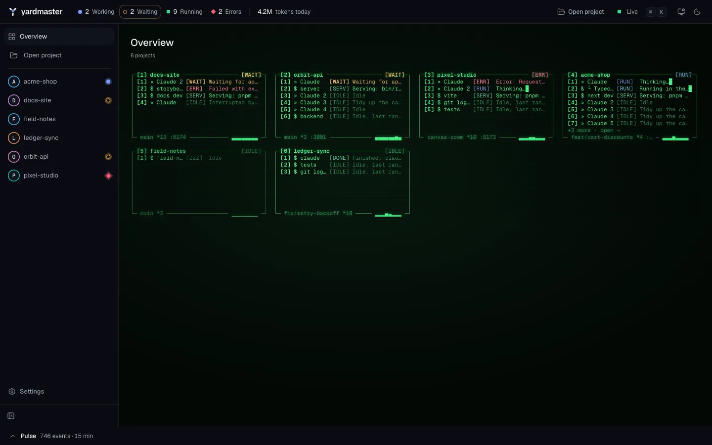
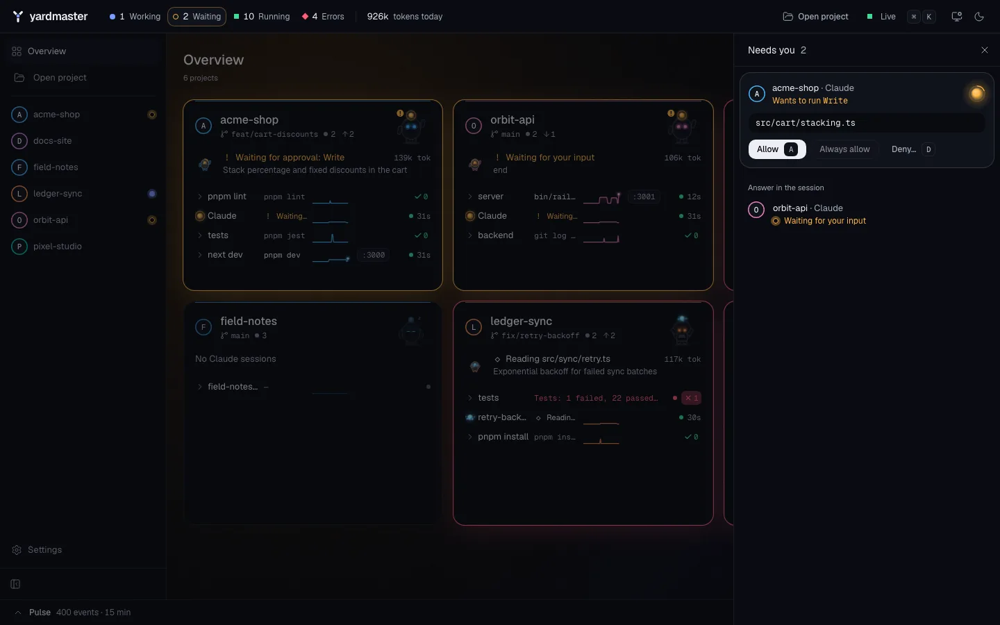
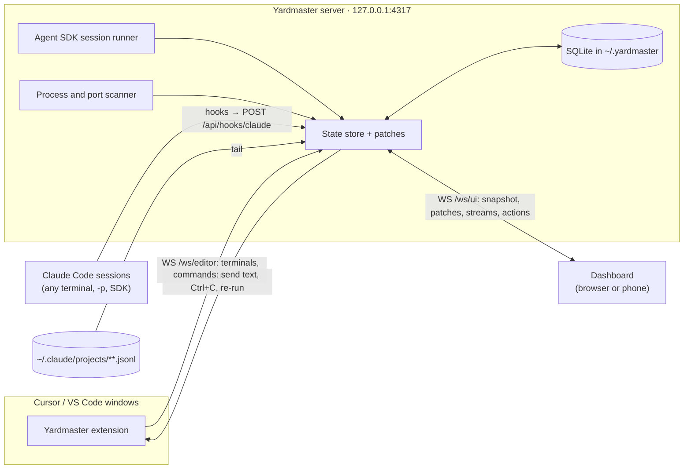

<p align="center">
  <picture>
    <source media="(prefers-color-scheme: dark)" srcset="docs/brand/hero-dark.svg">
    
  </picture>
</p>

# Yardmaster

**Mission control for your local dev work.** See every project you have open in one live, animated dashboard: every Cursor/VS Code terminal, every dev server, and every Claude Code session. You can act on them from there too: approve Claude's permission requests, chat with Claude, restart a crashed backend, or send Ctrl+C.

Your workflow doesn't change. You keep using Cursor and its terminals exactly as before; Yardmaster watches from the side and runs entirely on your machine.



<sub>All screenshots come from demo mode (`pnpm dev:demo`): the projects, paths and sessions are synthetic.</sub>

## Layouts

The overview shows the same projects, statuses and actions in five layouts. Switch with <kbd>Alt</kbd>+<kbd>1</kbd>…<kbd>5</kbd>, the command palette (<kbd>⌘</kbd><kbd>K</kbd>) or Settings.

| | |
|---|---|
| **Minimal** (default): one pod per project, attention first. | **Office:** each project is a room, every session and terminal a character at its desk. |
|  |  |
| **Grid:** a 3D network of projects fed by pipelines; dive into a node to reach its screens. | **Transit:** a metro map where each project is a line and every session or terminal a train. |
|  |  |
| **Retro:** a dense green-phosphor console, driven by number keys. | **Needs you:** permission requests and questions, answered from anywhere on the board. |
|  |  |

## Features

- **Every terminal, live.** The editor extension mirrors Cursor/VS Code terminals with full colored output, commands, exit codes, CPU, memory and listening ports. Send input, Ctrl+C, re-run, open a new terminal or jump to it in Cursor.
- **Every Claude Code session.** Hooks report each session's status in real time (thinking, running a tool, waiting for approval, done, failed), with its current tool, todo list, subagents, tokens and context. Open any transcript, history plus live tail, with tool calls rendered as cards and diffs.
- **Claude from the board.** Start headless sessions per project through the Claude Agent SDK: multi-turn chat, streaming, interrupt, model and permission-mode switch, resume past sessions.
- **Approvals.** Allow once, always allow or deny with a reason, from the board or your phone. With **away mode**, permission prompts from your terminal sessions come to the board too.
- **Attention first.** Waiting and failing work rises to the top, with in-app toasts and optional browser notifications. No sound.
- **Activity at a glance.** Every busy session and terminal has a live, cheap animation, so ten projects at once stay readable.
- **Pulse.** A cross-project activity timeline with filters, plus git status, ports and daily stats per project.
- **Open project.** Pick root folders once; launch any project from them into Cursor, a Claude session and its terminals in one step. Only active projects stay on the overview.
- **Board terminals.** Fully interactive terminals for projects with no editor window open, started from the board or the phone.
- **Phone access** over your own Tailscale network, with QR pairing and phone-ready screens.
- **Keyboard and motion.** A command palette for every action, full keyboard navigation, light and dark themes, and a Motion setting (Full, Reduced, Off) that also honors `prefers-reduced-motion`.

## How it works



- A small **editor extension** (Cursor and VS Code) streams your integrated terminals to a local server through shell integration.
- **Claude Code hooks** report the status of every Claude session to the same server. They are async, add no delay to Claude and fail silently when the board is off.
- The **server** merges it all with a process and port scan and the session transcripts, and pushes live patches to the **dashboard**. It can also run its own headless Claude sessions through the Claude Agent SDK.

The details are in [docs/ARCHITECTURE.md](docs/ARCHITECTURE.md).

## Requirements

- macOS or Linux (the scanner uses `ps` and `lsof`, or `ss` on Linux).
- Node.js 22 or newer, and pnpm 9.
- [Claude Code](https://code.claude.com) installed and signed in (`claude` on your `PATH`).
- Cursor, or VS Code 1.93 or newer, for terminal mirroring.
- `curl`, which the hook script uses.

## Install

```bash
git clone <this repository's URL> yardmaster && cd yardmaster
pnpm i
pnpm build
```

To get a global `yardmaster` command, run `npm i -g .` in the clone after `pnpm build`. It links to the clone, so keep the clone and rerun `pnpm build` after you pull. Then `yardmaster start` works anywhere, and so does every `pnpm yardmaster …` command below without the `pnpm`.

**1. Start the board.**

```bash
pnpm board          # builds, then serves the board on http://127.0.0.1:4317
```

It prints a one-time sign-in link (single use, valid for 5 minutes); open it in your browser. `pnpm yardmaster open` makes a new one for another browser. A first-run guide checks each step below with you.

**2. Install the Claude Code hooks.** They are merged into `~/.claude/settings.json` after a timestamped backup, and never touch your other hooks. Add `--dry-run` to see the diff first, or `--away` to also install the away-mode permission hook.

```bash
pnpm yardmaster hooks install
```

**3. Install the editor extension**, then reload every Cursor window:

```bash
pnpm --filter yardmaster-extension package
cursor --install-extension apps/extension/dist/yardmaster.vsix --force
```

For VS Code, use `code --install-extension` instead. Terminals show their output from the next command they run; a process that was already running shows up with "restart to capture".

**4. Check the setup** with `pnpm yardmaster doctor`.

### Add a projects folder

Projects appear on their own when a Cursor window or a Claude session opens them. To launch the rest from the board, open **Settings → Project folders → Add folder** and pick the folder that holds your projects (for example `~/code`). **Open project** (<kbd>⌘</kbd><kbd>K</kbd> or the top bar) then lists the folders directly inside it. Yardmaster only reads their names and whether they are git repositories.

### Phone access

Yardmaster only ever listens on `127.0.0.1`. To use it from your phone, put both devices on your own [Tailscale](https://tailscale.com) network, run `tailscale serve --bg 4317`, allow the host in **Settings → Phone** and scan the pairing QR code. The full guide is in [docs/phone.md](docs/phone.md). Public tunnels are not supported: the board can type into your terminals.

## Privacy

**Yardmaster runs locally, uses your own Claude Code login, and has no telemetry.**

- The server binds `127.0.0.1` only, checks the `Host` and `Origin` of every request, and requires a per-install token (`~/.yardmaster/token`, mode 0600) or a browser session. Each browser signs in with a one-time link and keeps its own session in the board's own storage, never in a cookie, so dev servers on other ports of the same host never see it. Settings lists every signed-in browser and phone and can sign any of them out.
- The editor extension and the Claude hooks talk to it only through a socket in `~/.yardmaster` that only you can reach, so another program holding the port can't collect the token or answer in Yardmaster's place.
- It never reads your Claude credentials (`~/.claude/.credentials*`, the Keychain, `~/.claude.json`) and never asks for an API key. If `ANTHROPIC_API_KEY` is set in the server's environment, the Agent SDK bills that key instead; `doctor` warns about it.
- It makes no network calls of its own. Fonts and assets are bundled.
- Terminal output and transcripts stay in memory and in a local SQLite file under `~/.yardmaster`. The **Redact secrets** setting masks common secret patterns on screen.

## Uninstall

```bash
pnpm yardmaster hooks uninstall                            # removes only Yardmaster's entries, after a backup
cursor --uninstall-extension yardmaster.yardmaster-extension
rm -rf ~/.yardmaster                                       # token, settings, history
```

If you shared any dev server ports to your phone, `tailscale serve reset` stops them.

## Troubleshooting

Run `pnpm yardmaster doctor` first. It checks Node.js, the token, whether the server is up, the Claude hooks, connected editor extensions, the editor CLI, board terminals (`node-pty`), the `claude` binary and billing, and says what to do about each problem.

- **"Port 4317 is already in use":** the board is already running, or something else owns the port. Set `YARDMASTER_PORT` to use another one.
- **No Claude sessions show up:** check `pnpm yardmaster hooks status`, then restart your Claude sessions: Claude Code reads its hooks when a session starts.
- **A terminal says "output unavailable":** it was running before the extension started. Restart the command.
- **Board sessions were interrupted:** the server restarted (for example `pnpm dev` after an edit). Use **Resume**; `pnpm board` gives you a board that stays up.
- **Signed out in the browser:** run `pnpm yardmaster open` (or Yardmaster: Open Dashboard in your editor) for a new one-time sign-in link. `pnpm yardmaster token --rotate` signs out every browser and phone.

## Contributing

```bash
pnpm dev:demo       # server and web in watch mode (web on http://127.0.0.1:4327), with synthetic demo data
pnpm check          # privacy check, lint, typecheck and unit tests
pnpm e2e            # Playwright against the demo board
pnpm shots          # screenshots into artifacts/shots/
```

- Read [docs/PRD.md](docs/PRD.md) for the product and [docs/DESIGN.md](docs/DESIGN.md) for the UI and motion spec, and [docs/ARCHITECTURE.md](docs/ARCHITECTURE.md) for how the parts fit. [CLAUDE.md](CLAUDE.md) has the engineering conventions.
- This is a public repo: never commit personal or machine-specific data. Fixtures and demo data are synthetic. `scripts/privacy-check.sh` runs before every commit and must pass.
- `pnpm check` must pass before a change is done. UI changes follow DESIGN.md and come with screenshots from demo mode; refresh the README images with `scripts/readme-shots.sh` after `pnpm shots` and `pnpm e2e`.

### Building with the loop

Most of this repo is built task by task from [PLAN.md](PLAN.md) by an unattended Claude Code loop:

```bash
loop/loop.sh            # runs one PLAN.md task per iteration, commits, pushes
touch loop/.state/STOP  # stop after the current iteration
```

The loop pauses at tasks tagged **[HUMAN]**, such as installing the hooks and the extension on your machine.
